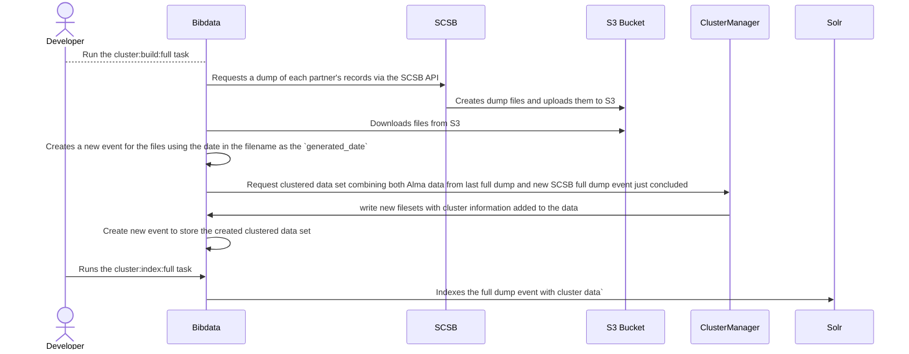
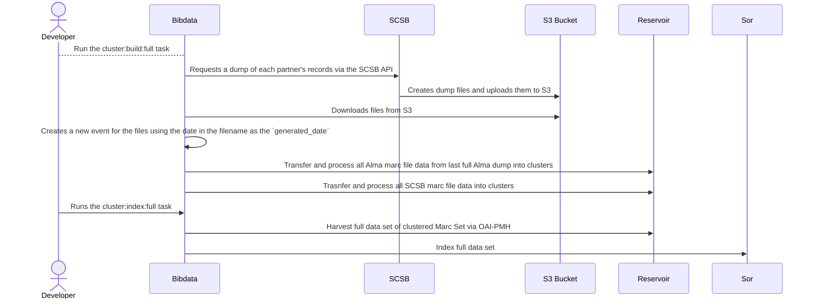
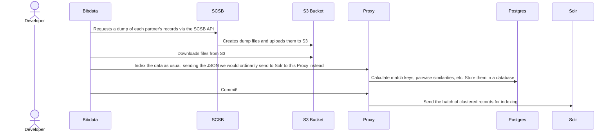
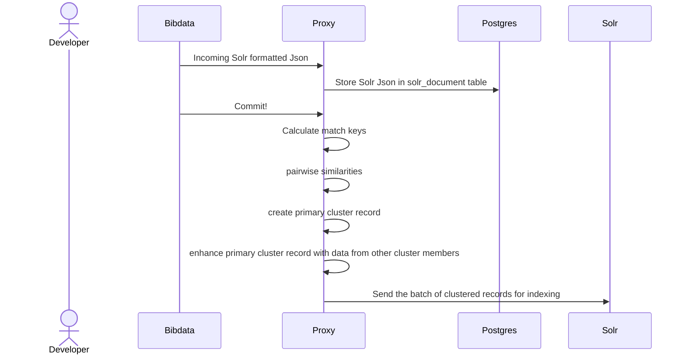
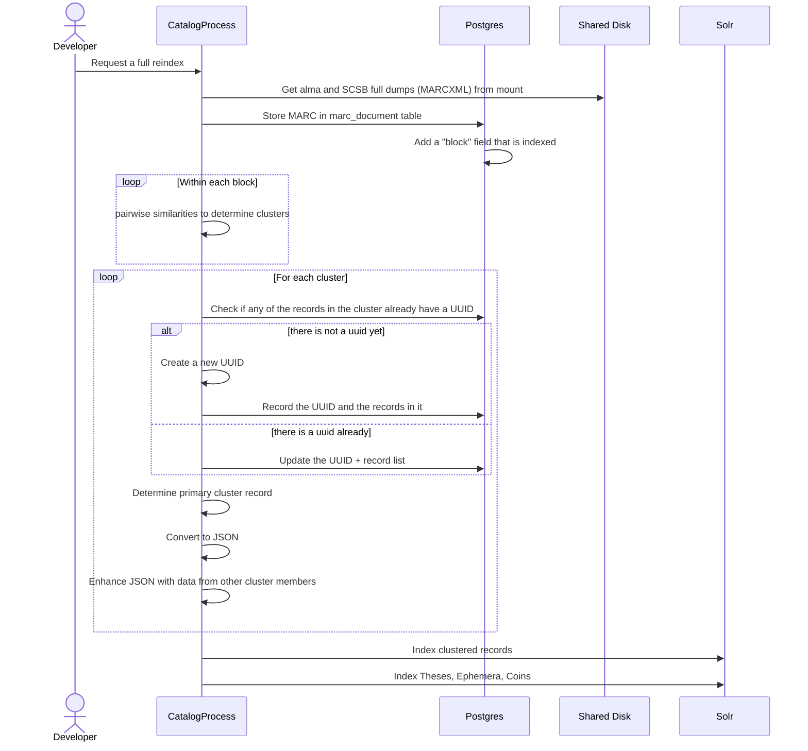
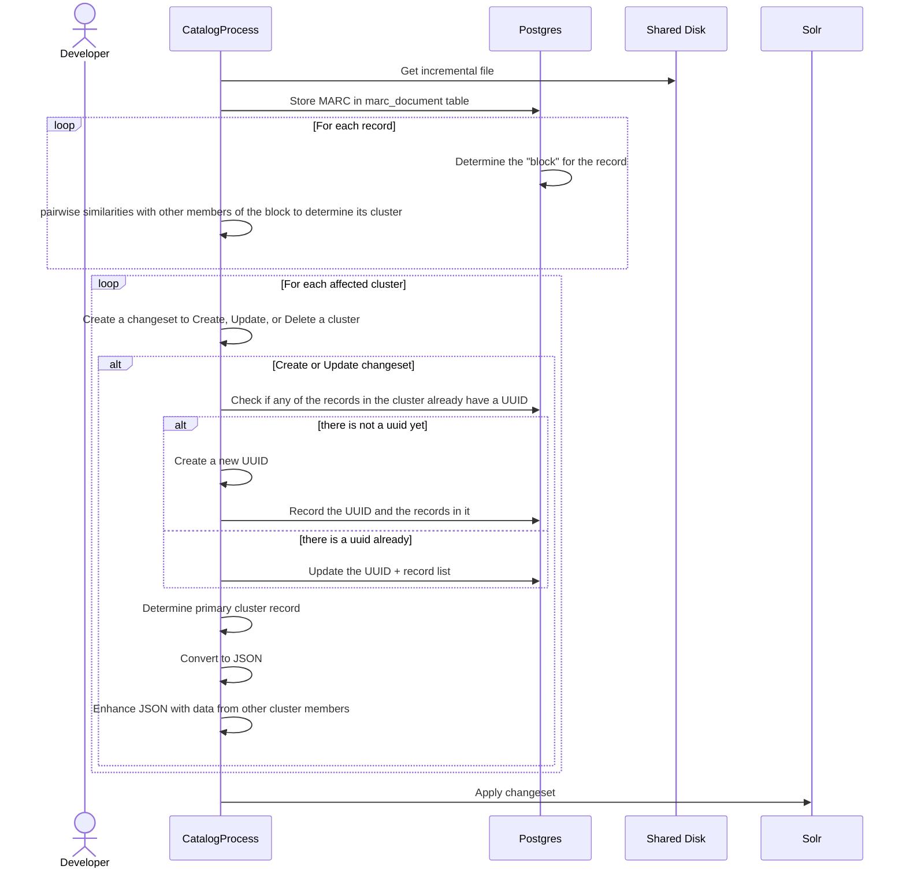

Alternative Process using Reservoir

Another idea: A proxy server in front of solr

Indexing Pipeline

Yet another idea: all data processing in the same system

For full dump, bibdata would still be responsible for making sure that Alma records are downloaded to the shared mounted disk.  Then...

For incremental:

